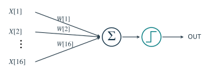
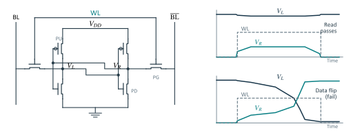
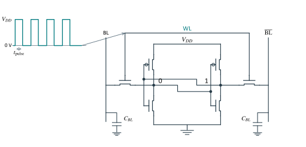

# EE6316 | Quiz 2

AY2026-2027 Semester 1 | 10 questions | 10 marks each | 50 minutes

## 1. Neural-network arithmetic (10 marks)

Which arithmetic operation dominates computation in convolutional neural networks (CNNs)?

## 2. The von Neumann limitation (10 marks)

Briefly explain the main limitation of a von Neumann architecture when it is used to execute neural networks.

## 3. Multi-bit inputs in memory-compute arrays (10 marks)

With weights stored in a memory array, describe two ways to represent a multi-bit input for computation-in-memory.

## 4. ReRAM macro design (10 marks)

State two important challenges in designing a ReRAM-based computation-in-memory macro.

## 5. Analog computation-in-memory (10 marks)

List three challenges associated with analog computation-in-memory.

## 6. Mapping a binary neuron (10 marks)

The neuron in Figure 1 has 16 inputs. Both $X[i]$ and $W[i]$ are binary. How many memory cells are needed to implement the neuron in one column of a memory array?

## 7. ReRAM multi-bit multiplication (10 marks)

How many ReRAM cells are required to realize a 2-bit input multiplied by a 2-bit weight in a column in one cycle? Use the column organization associated with the course example.

## 8. SRAM read behavior (10 marks)

Figure 2 illustrates an SRAM read operation. Briefly explain the issue indicated by the circuit and the two waveform cases.

## 9. Bitline swing in a 6T SRAM MAC (10 marks)

Figure 3 shows a multi-bit multiply-and-accumulate (MAC) operation using a 6T SRAM cell. A multi-bit input is encoded by multiple pulses of amplitude $V_{DD}$. For $V_{DD}=1.2\,\mathrm{V}$ and $V_{tn}=0.4\,\mathrm{V}$, what is the maximum voltage swing on $\mathrm{BL}$ and $\overline{\mathrm{BL}}$ that can generate analog MAC results without significant nonlinearity?

## 10. Differential MAC output levels (10 marks)

For the circuit in Figure 3, how many differential voltage levels can be produced as MAC results?
